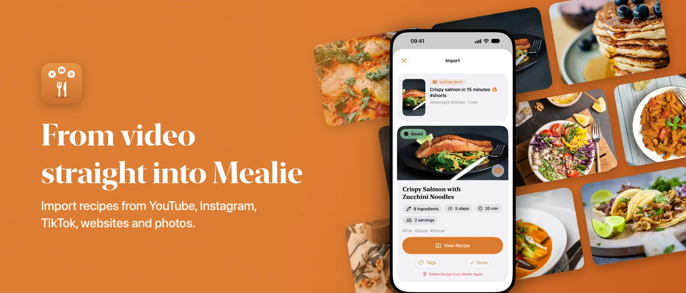
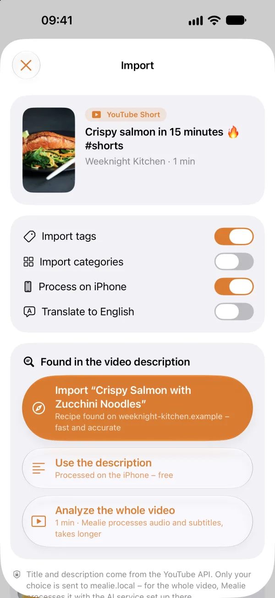
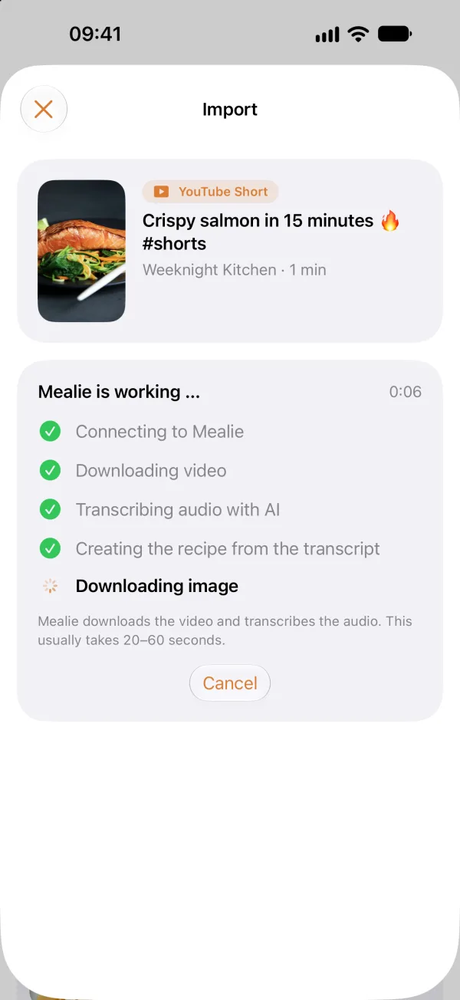
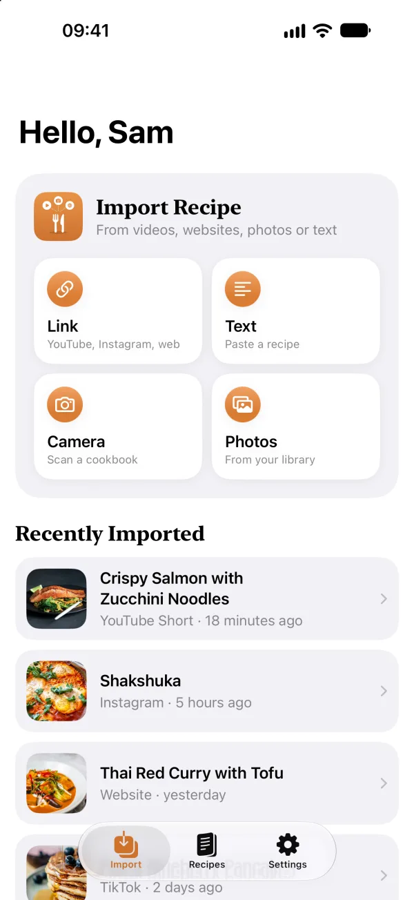
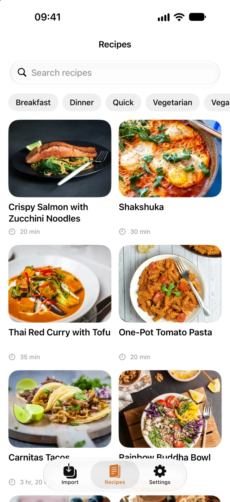
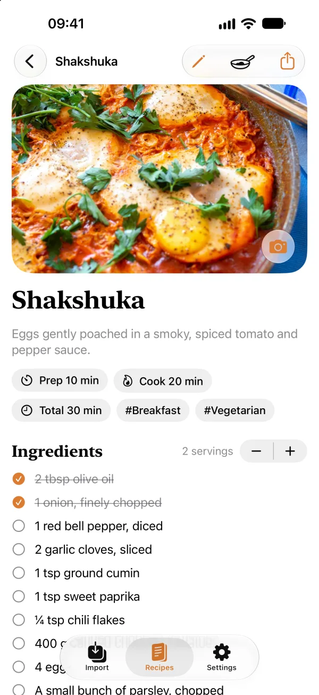

<p align="center">
  
</p>

<h1 align="center">Recipe2Mealie</h1>

<p align="center">
  <b>Recipes from videos, websites, photos and text – straight into your own <a href="https://mealie.io">Mealie</a>.</b><br>
  iPhone &amp; iPad · iOS 26 · English &amp; German · no tracking
</p>

<p align="center">
  <a href="https://apps.apple.com/app/id6816929559">
    
  </a>
</p>

## 💡 Why I built this

For a long time I was looking for a quick, lightweight way to get recipes I stumble upon on social media into
Mealie – straight from my iPhone, without any hassle. Apple's on-device AI makes that possible at no extra cost,
but Shortcuts kept running into their limits.

And then there's the *wife acceptance factor*: importing a recipe has to be effortless, and so does searching our
Mealie instance for tonight's dinner. I couldn't find an app that did both – so I built one.

<p align="center">
  
</p>

> **Unofficial app.** Recipe2Mealie is an independent project, not affiliated with or endorsed by Mealie.

## 🧠 AI on your iPhone – or on your server

Every import picks the best way to get the recipe. You decide where the AI runs.

<table>
  <tr>
    <td width="50%" valign="top">
      <h3>📱 On-device</h3>
      Photos, cookbook scans, pasted text and YouTube descriptions are read with <b>Vision</b> and turned into a
      recipe by <b>Apple Intelligence</b> – entirely on the iPhone. Free, fast, private: Mealie only receives the
      finished recipe.
    </td>
    <td width="50%" valign="top">
      <h3>☁️ Mealie server</h3>
      For whole videos, Mealie downloads the audio, uses subtitles or transcribes it with the
      <a href="https://docs.mealie.io/documentation/getting-started/installation/ai-providers/">AI provider</a>
      you configured. Also the fallback for devices without Apple Intelligence.
    </td>
  </tr>
  <tr>
    <td align="center"></td>
    <td align="center"></td>
  </tr>
</table>

Recipe websites – and YouTube videos that link to one – need no AI at all: Mealie reads the page's structured
recipe data directly.

## ✨ Features

- 🔗 **Share to import** – YouTube Shorts, Instagram Reels, TikTok or any recipe website, from any app
- 🔍 **Description first** – finds the recipe link or text in a video's description before transcribing anything
- 📸 **Scan cookbooks** – document camera, photo library or pasted text
- 📖 **Recipe browser** – search, tag filters, scale amounts (even from what you have left), cooking mode
- 🔐 **Sign in your way** – Mealie account, API token or your OIDC provider (Pocket ID, Authentik, …)
- ✏️ **Edit everything** – every field, plus cover images from camera, photos or Image Playground
- 🔒 **Private by design** – no accounts, no analytics; recipes only go to *your* server

<p align="center">
  
  
  
</p>

## 🚀 Get started

[Download Recipe2Mealie on the App Store](https://apps.apple.com/app/id6816929559)

1. Enter your Mealie server address and sign in (account, API token or OIDC).
2. Share a video, website or photo to **Recipe2Mealie** – or use the import screen.

No server? Tap **Try without a server** to explore with sample recipes.

**Needs:** iOS / iPadOS 26 · Mealie 3.x · an AI provider with audio transcription for video imports ·
Apple Intelligence for on-device processing

## 🔐 Sign in with OIDC

If your Mealie signs in through an OpenID Connect provider such as Pocket ID, Authentik or Keycloak, the app can
use it too. As soon as you enter the server address, it shows **Sign in with …** (named after
`OIDC_PROVIDER_NAME`). The sign-in opens in the system browser, so passkeys and password managers work as usual.
Afterwards the app creates its own API token in Mealie, which you can revoke under **Profile → API Tokens**.

**Requirements:** Mealie 3.23 or later with [OIDC set up](https://docs.mealie.io/documentation/getting-started/authentication/oidc-v2/).

**One-time setup in your provider:** allow the app's callback URL on the OIDC client that Mealie already uses:

```
de.recipe2mealie.app:/oauth/callback
```

| Provider | Where to add it |
|---|---|
| Pocket ID | *OIDC Clients* → your Mealie client → *Callback URLs* |
| Authentik | *Applications → Providers* → your Mealie provider → *Redirect URIs* |
| Keycloak | *Clients* → your Mealie client → *Valid redirect URIs* |

Keep the existing callback URL for Mealie's web login. Nothing changes in Mealie itself: the app exchanges the
login through Mealie's endpoints for native apps, with the client and secret Mealie already has.

**Google and Microsoft** don't allow custom callback URLs on a web client. They need a separate client for apps,
set with `OIDC_NATIVE_CLIENT_ID` and `OIDC_NATIVE_CONFIDENTIAL=false`. These settings come with the first Mealie
release after 3.28; see [Mealie's guide](https://docs.mealie.io/documentation/getting-started/authentication/oidc-v2/#public-native-clients-google-microsoft).

<details>
<summary>Troubleshooting</summary>

- **No "Sign in with …" button:** OIDC isn't enabled in Mealie, or Mealie is older than 3.23 (the app then says so
  below the server address).
- **The provider reports an invalid redirect or callback URL:** the callback URL above is missing on Mealie's
  client.
- **"Mealie refused the sign-in":** the provider accepted you, but Mealie didn't – for example because the user
  isn't in `OIDC_USER_GROUP` or `OIDC_SIGNUP_ENABLED` is off. Mealie's log says why.

</details>

## 💬 Feedback & contributing

[Support page](https://rainerzufall00.github.io/recipe2mealie/support) · [Open an issue](https://github.com/RainerZufall00/recipe2mealie/issues/new/choose) · or use *Feedback* in the app's
settings. Pull requests are welcome – see [CONTRIBUTING.md](CONTRIBUTING.md).

Privacy: the app talks only to your Mealie server and, for YouTube links, the YouTube Data API.
[Privacy Policy](https://rainerzufall00.github.io/recipe2mealie/privacy)

## ☕ Support

Recipe2Mealie is free, without ads or subscriptions. If it saves you time in the kitchen, you can buy me a coffee:

<a href="https://buymeacoffee.com/rainerzufall00">
  
</a>

## License

Code: [MIT License](LICENSE). The name **Recipe2Mealie** and the app icon are not covered – if you publish your
own build, please use a different name and icon. *Mealie* is an independent open-source project. *YouTube* is a
trademark of Google LLC. This app uses YouTube API Services; see the
[YouTube Terms of Service](https://www.youtube.com/t/terms) and the
[Google Privacy Policy](https://policies.google.com/privacy).

<details>
<summary>Demo photos</summary>

The demo mode uses eight photos from [Unsplash](https://unsplash.com), in
`Packages/MealieKit/Sources/MealieKit/Resources/DemoImages/` (also visible in the screenshots above). They are
covered by the [Unsplash License](https://unsplash.com/license), not the MIT License: free to use, but not to be
sold unaltered or used to build a competing photo service.

| Recipe | Photo by |
|---|---|
| Crispy Salmon with Zucchini Noodles | [Caroline Attwood](https://unsplash.com/photos/bpPTlXWTOvg) |
| Shakshuka | [Yoav Aziz](https://unsplash.com/photos/422N7Nwq5XY) |
| Thai Red Curry with Tofu | [iMattSmart](https://unsplash.com/photos/wgvbmn4d0Wk) |
| One-Pot Tomato Pasta | [Aleksandra Tanasiienko](https://unsplash.com/photos/0y6eMd8vevA) |
| Carnitas Tacos | [Frankie Lopez](https://unsplash.com/photos/_j4S4V2C8ew) |
| Rainbow Buddha Bowl | [Mariana Medvedeva](https://unsplash.com/photos/fk6IiypMWss) |
| Fluffy Blueberry Pancakes | [Adam Bartoszewicz](https://unsplash.com/photos/s8iYlK9ByQE) |
| Banana Bread | [Cody Chan](https://unsplash.com/photos/a0fBbS8RZAo) |

</details>
